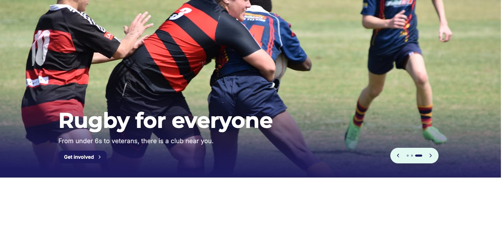
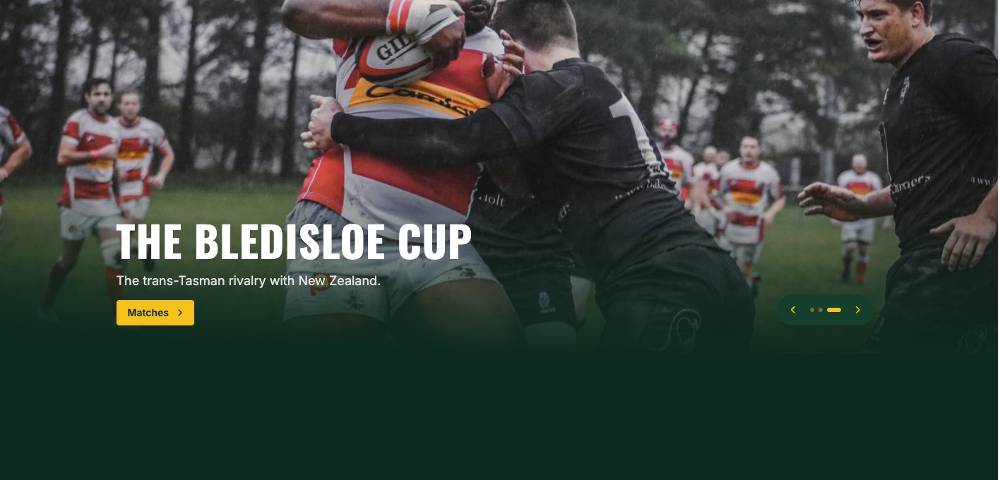
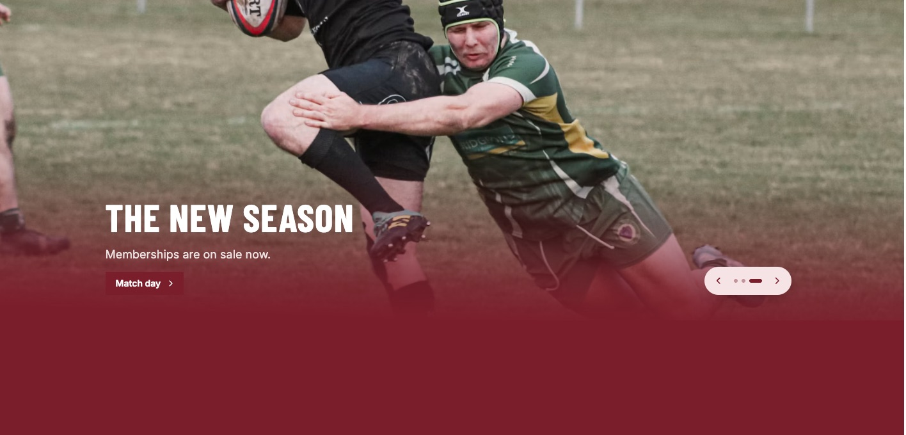
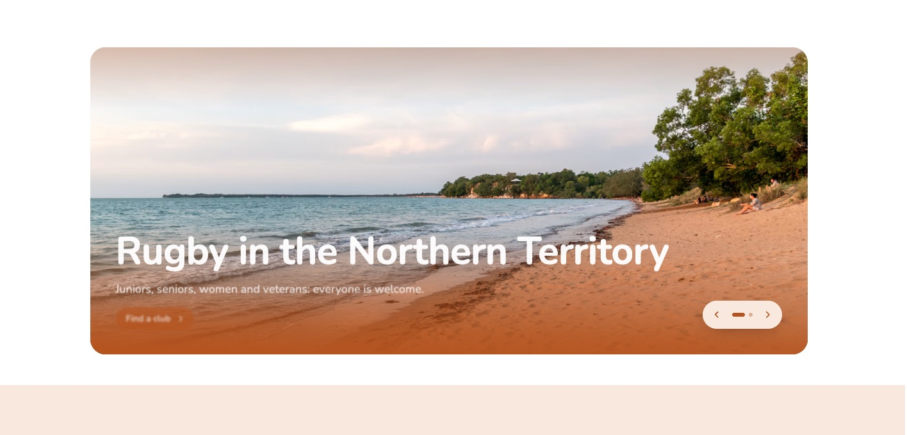
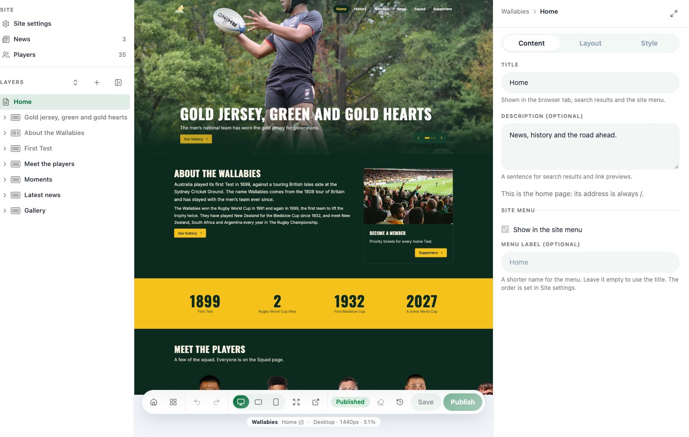
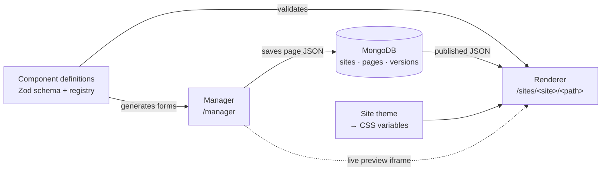
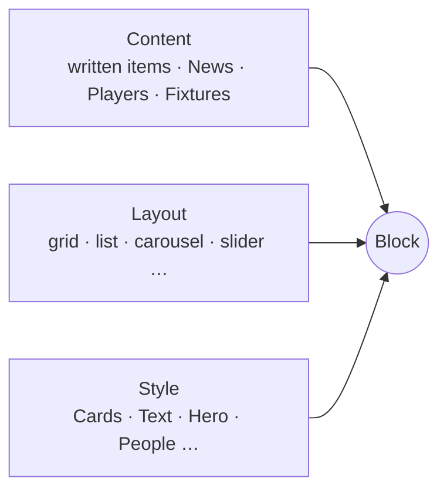

# Multi-Site Website Manager

One Next.js app that runs many rugby websites from one shared component library.
Editors compose pages in a manager whose forms are generated from each component's
schema. Public pages are server-rendered from portable page JSON, each site in its
own theme.

**Live demo**: [Manager](https://rugby-site-manager.vercel.app/manager) ·
Vercel + MongoDB Atlas (Sydney). No login, as the brief allows.

## Same components, four themes

|                   [Rugby Australia](https://rugby-site-manager.vercel.app/sites/rugby-australia)                   |                [Wallabies](https://rugby-site-manager.vercel.app/sites/wallabies)                |
| :----------------------------------------------------------------------------------------------------------------: | :----------------------------------------------------------------------------------------------: |
| [](https://rugby-site-manager.vercel.app/sites/rugby-australia) | [](https://rugby-site-manager.vercel.app/sites/wallabies) |
|                                     Governing body · Montserrat, soft corners                                      |                                National team · Oswald, uppercase                                 |
|                      [**Queensland Reds**](https://rugby-site-manager.vercel.app/sites/reds)                       |               [**NT Rugby**](https://rugby-site-manager.vercel.app/sites/nt-rugby)               |
|                 [](https://rugby-site-manager.vercel.app/sites/reds)                  |  [](https://rugby-site-manager.vercel.app/sites/nt-rugby)   |
|                                    Super Rugby club · Barlow Condensed, square                                     |                                   State union · Nunito, round                                    |

The seed has 15 sites (about 100 pages, 46 articles and 247 players). No component
code differs between them, only theme tokens.

## The manager



Layers on the left, a live preview in the middle (an iframe of the real renderer),
one generated form on the right. Edit, **Save draft**, then **Publish**. Every
publish is kept as a version you can restore.

## Run it

Requires Node 22+, npm and Docker.

```sh
cp .env.example .env.local
docker compose up -d   # MongoDB on localhost:27017
npm install
npm run seed           # drops and recreates the sample data
npm run dev            # http://localhost:3000/manager
```

Checks: `npm test`, `npm run lint`, `npm run typecheck`, `npm run build`.

## Architecture



The four parts meet only through the component registry. The manager never imports
render code, and a stored page holds only `type`, `props` and `children`, so it
renders without the manager running.

| Layer                 | Where                                               |
| --------------------- | --------------------------------------------------- |
| Page data             | `lib/db/`, `lib/types.ts`                           |
| Component definitions | `lib/components/` (Zod, no React)                   |
| Manager               | `app/manager/`, `components/manager/`, `lib/forms/` |
| Renderer              | `app/sites/`, `components/site/`, `lib/theme/`      |

Shared UI primitives (Button, Dialog…) live in `packages/ui`.

## Component model

A page is a tree of **Sections** (the container: columns, background, width) holding
**blocks** or more Sections. Every block is three choices:



Item types, layouts and data sources are each written once and combine freely. The
brief's Card Grid is _Cards × grid × written items_. A news carousel or a squad
grid needs no new code. A source fits a block when it fills the fields the block
needs, and the editor only offers what fits.

## Page JSON

One document per page, with `draft` and `published` copies. `components` is the
portable part:

```json
{
  "siteSlug": "wallaroos",
  "path": "/news",
  "draft": {
    "title": "News",
    "components": [
      {
        "id": "59c4b7e8-…",
        "type": "section",
        "props": { "columns": "1", "background": "none" },
        "children": [
          {
            "id": "be53c5df-…",
            "type": "cards",
            "props": {
              "content": { "from": "news", "mode": "latest", "limit": 12 },
              "layout": { "arrange": "grid", "featured": true },
              "style": { "look": "card", "ratio": "wide" }
            }
          }
        ]
      }
    ]
  },
  "published": { "…": "same shape, plus version and publishedAt" }
}
```

The public route reads only `published`, so a never-published page is a 404.

## Adding a component

1. **Define it** in `lib/components/blocks/quotes.ts`:

   ```ts
   export const quotes = defineBlock({
     type: 'quotes',
     label: 'Quotes',
     roles: { text: required('Quote'), title: required('Who said it') },
     style: z.object({ size: z.enum(['m', 'l']).meta({ label: 'Size' }) }),
     defaults: { layout: { arrange: 'slider' }, style: { size: 'l' } },
   });
   ```

2. **Draw one item** in `components/site/blocks/QuoteItem.tsx` (props typed from
   the definition).
3. **Register it** in `lib/components/registry.ts` and `components/site/siteComponents.ts`.

The form, the "Add a block" picker, layouts, data sources and validation all come
from the definition. **A new prop** is one line in the schema, and it must be
`.optional()` or have a `.default()` so stored pages stay valid.

## Key decisions

- **Zod over JSON Schema.** One schema gives the TypeScript type, runtime
  validation and the form description.
- **Blocks = item × layout × source**, not one component per combination. More
  reach per line of code. The cost is nested props.
- **Preview is an iframe of the real renderer.** It can't drift from the public
  site. The cost is that blocks are dragged in Layers, not on the canvas.
- **Whole page as one document.** Portable and matches how it renders. The cost is
  that Sections can't be shared yet, and the last save wins.
- **Official MongoDB driver**, not Mongoose. Zod already validates, so the driver
  stays thin, and all calls live in `lib/db`.
- **Path routing** (`/sites/<slug>`) needs no DNS locally. Custom domains would be
  a middleware rewrite.

**Not built yet:** shared Sections, auth with per-site roles, version diff, image
upload, conflict detection on concurrent saves.

Full write-up (theming, versions, assumptions, image credits):
[docs/design-notes.md](docs/design-notes.md).

## Time and tools

- About **TODO** hours. The stretch goals (draft/publish, live preview, data
  sources, deploy) came after the must-haves worked.
- AI: **Codex** and **Claude Code** for scaffolding, implementation and review. I
  reviewed every change and can explain or change any line without them.

## Deployment

One Vercel project (root `apps/web`, see [`vercel.json`](apps/web/vercel.json))
serves the manager and every site. `MONGODB_URI` and `MONGODB_DB` point at an
Atlas M0 cluster. Seed it once from a laptop:

```sh
MONGODB_URI="mongodb+srv://…" npm run seed
vercel deploy --prod
```
